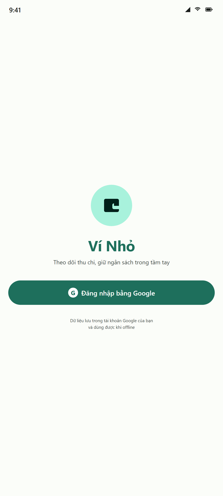
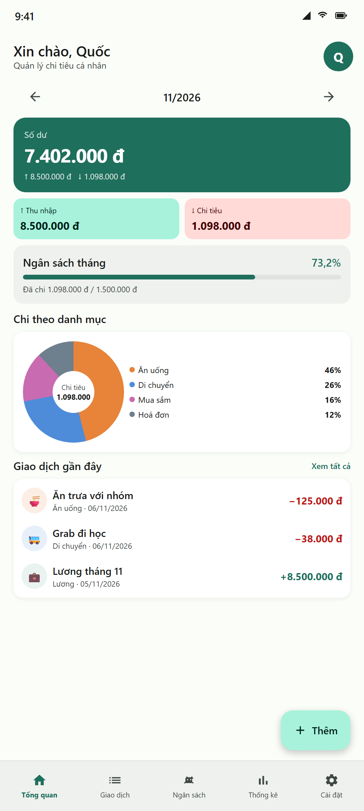
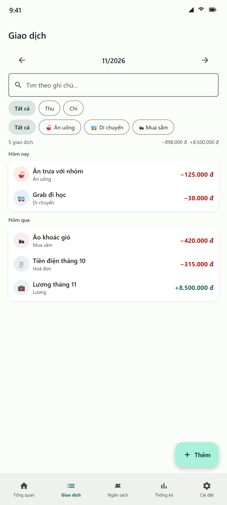
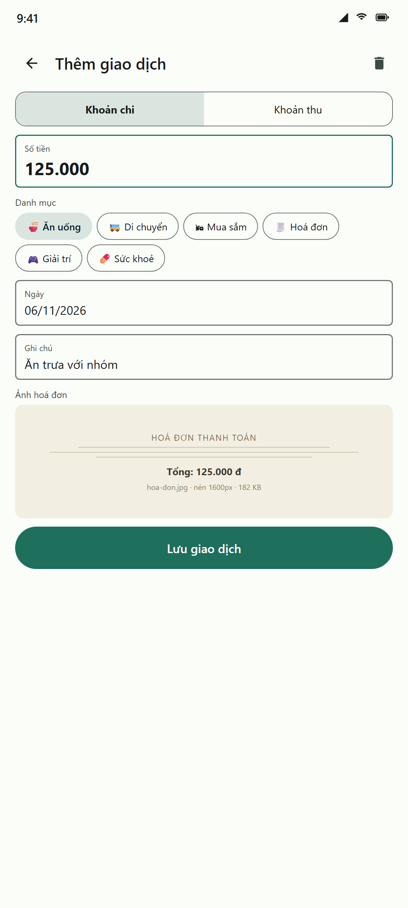
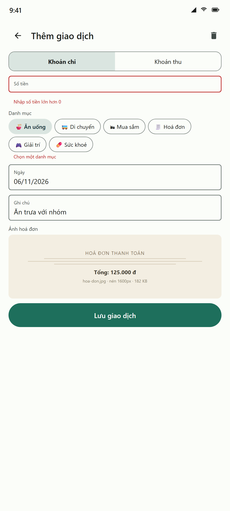
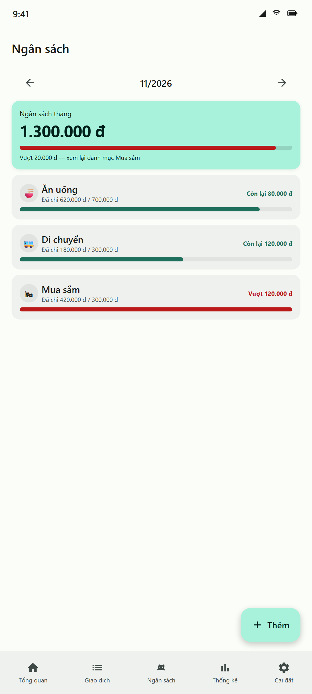
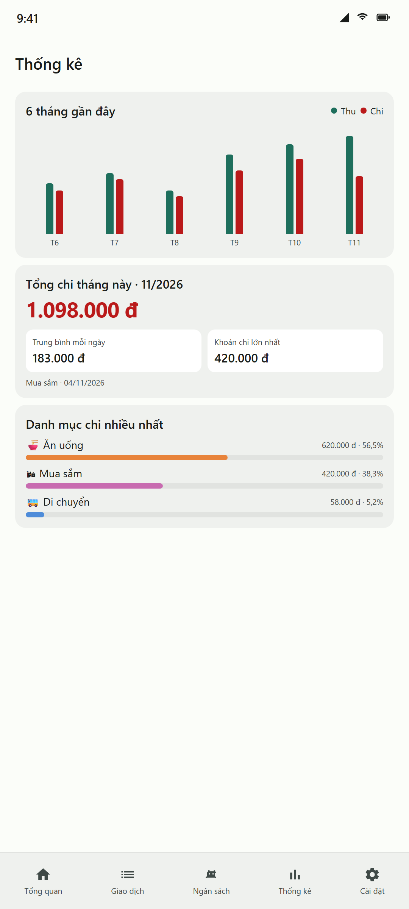
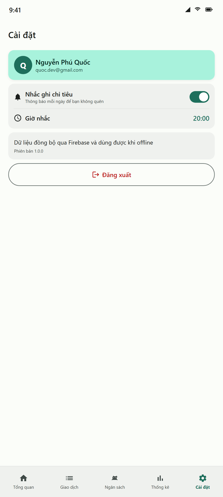
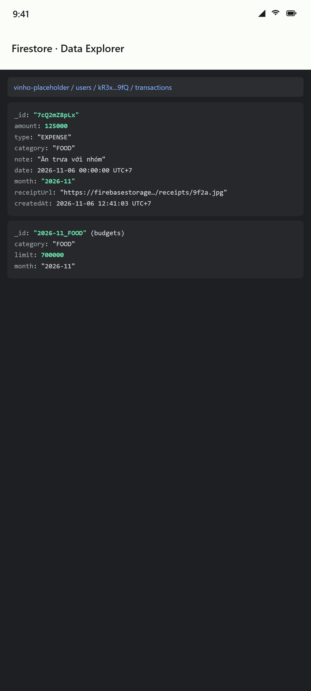

# Ví Nhỏ — Quản lý chi tiêu cá nhân

[](https://github.com/charrisay2/Final_Android/actions/workflows/android.yml)

Ứng dụng Android ghi thu/chi theo danh mục, đặt ngân sách tháng, xem biểu đồ thống kê và chụp ảnh hoá đơn.
Dữ liệu lưu trên **Cloud Firestore** (dùng được khi offline), ảnh hoá đơn trên **Cloud Storage**, đăng nhập **Google qua Firebase Auth + Credential Manager**, nhắc ghi chi tiêu hằng ngày bằng **WorkManager + notification**.

| | |
|---|---|
| **Repo** | https://github.com/charrisay2/Final_Android |
| **Sinh viên** | Nguyễn Phú Quốc |
| **MSSV** | 2431540075 |
| **Đề tài** | Đề tài 2 — Quản lý chi tiêu cá nhân |
| **Package** | `com.example.vinho` |
| **minSdk / targetSdk / compileSdk** | 26 / 36 / 36 |
| **Kotlin / AGP / KSP** | 2.2.21 / 8.8.2 / 2.2.21-2.0.5 |
| **Firebase BoM** | 34.0.0 (Auth · Firestore · Storage) |
| **Ngôn ngữ** | Kotlin + 100% Jetpack Compose (Material 3) |

---

## 1. Ảnh chụp màn hình

| Đăng nhập | Tổng quan | Giao dịch |
|---|---|---|
|  |  |  |

| Thêm giao dịch | Lỗi validate | Ngân sách |
|---|---|---|
|  |  |  |

| Thống kê | Cài đặt | Firestore |
|---|---|---|
|  |  |  |

> Ảnh UI là **bản render minh hoạ từ layout Compose** (máy làm bài không có AVD), không phải ảnh chụp emulator.
> `09-firestore.png` là mô phỏng Data Explorer. Khi chạy thật, bạn nên chụp lại màn hình emulator + Firestore Console.

---

## 2. Chức năng

| # | Màn hình | Chức năng |
|---|---|---|
| 1 | **Đăng nhập** | Google Sign-In qua Credential Manager → Firebase Auth. Tự vào app nếu đã đăng nhập (kể cả sau khi kill app). |
| 2 | **Tổng quan** | Số dư / tổng thu / tổng chi của tháng, biểu đồ vành khuyên theo danh mục, tiến độ ngân sách, 5 giao dịch gần nhất. Chuyển tháng bằng ‹ ›. |
| 3 | **Giao dịch** | Danh sách nhóm theo ngày ("Hôm nay", "Hôm qua", dd/MM/yyyy), tìm theo ghi chú, lọc theo loại (Thu/Chi) và theo danh mục, tổng thu/chi của kết quả lọc. |
| 4 | **Thêm / Sửa giao dịch** | Một form dùng chung: chọn Thu/Chi, số tiền, danh mục (chip), ngày (DatePicker), ghi chú, **ảnh hoá đơn** (Photo Picker → nén → Cloud Storage). Sửa thì điền sẵn dữ liệu, có nút xoá kèm hộp thoại xác nhận. |
| 5 | **Ngân sách** | Đặt giới hạn chi cho từng danh mục trong tháng, thanh tiến độ, cảnh báo vượt ngân sách, sửa/xoá ngân sách. |
| 6 | **Thống kê** | Biểu đồ cột thu/chi **6 tháng gần đây**, tổng chi tháng, trung bình mỗi ngày, khoản chi lớn nhất, top 5 danh mục chi nhiều nhất kèm tỉ lệ %. |
| 7 | **Cài đặt** | Hồ sơ Google, bật/tắt nhắc nhở hằng ngày + chọn giờ (TimePicker), đăng xuất (xoá cả Credential Manager state). |

Yêu cầu bắt buộc của đề bài — đối chiếu:

- [x] **≥ 5 màn hình có chức năng thật** → 7 màn hình, 100% Compose + Material 3
- [x] **Navigation Compose type-safe** → `@Serializable` route, `composable<T>`, `savedStateHandle.toRoute<T>()`
- [x] **MVVM: ViewModel + StateFlow + repository** → 7 ViewModel, `StateFlow<UiState>` bất biến, repository là interface
- [x] **DI bằng Hilt** → `@HiltAndroidApp`, `@HiltViewModel`, `@Binds`/`@Provides`, `@HiltWorker`
- [x] **Nguồn dữ liệu từ xa + offline** → Firestore + `persistentCacheSettings()` (đọc/ghi offline, tự đồng bộ)
- [x] **Đăng nhập Google qua Firebase Auth + Credential Manager** → chạy ở cả debug và release (xem mục 7)
- [x] **WorkManager + notification** → `ReminderWorker` (`@HiltWorker`) chạy mỗi ngày, giờ do người dùng chọn
- [x] **Runtime permission** → `POST_NOTIFICATIONS` (Android 13+) xin đúng lúc bật nhắc nhở, có xử lý khi bị từ chối
- [x] **≥ 3 unit test ViewModel + ≥ 1 Compose UI test** → 4 file test, 10 test case (mục 8)
- [x] **Bản release đã ký, bật R8** → `isMinifyEnabled` + `isShrinkResources`, signingConfig đọc từ `keystore.properties` (mục 9)
- [x] **README đầy đủ** → file này

Nâng cao đã làm: **đa ngôn ngữ Việt/Anh**, **animation** (chuyển màn hình, donut chart animate), **GitHub Actions** chạy unit test + lint cho mọi PR, **Security Rules** cho cả Firestore và Storage.

---

## 3. Kiến trúc

```
UI (Compose, stateless khi có thể)
   │  collectAsStateWithLifecycle()
   ▼
ViewModel (StateFlow<UiState>, không biết Firebase)
   │  gọi interface
   ▼
Repository (interface ở data layer)
   │  FirestoreTransactionRepository · FirestoreBudgetRepository
   │  FirebaseAuthRepository · FirebaseReceiptStorage · DataStoreSettingsRepository
   ▼
Firebase (Auth · Firestore offline cache · Storage)  +  DataStore  +  WorkManager
```

```
app/src/main/java/com/example/vinho/
├── ViNhoApp.kt                     @HiltAndroidApp, bật Firestore cache, tạo notification channel
├── MainActivity.kt                 @AndroidEntryPoint, edge-to-edge
├── core/
│   ├── Format.kt                   formatMoney, parseAmount, monthKey, formatDate… (hàm thuần, test được)
│   └── Errors.kt                   Throwable.toUserMessage()
├── data/
│   ├── model/Models.kt             Category (enum 12 danh mục), Transaction, TransactionDraft, Budget, UserProfile
│   ├── auth/AuthRepository.kt      interface + impl (Credential Manager → Firebase credential)
│   ├── transaction/TransactionRepository.kt
│   ├── budget/BudgetRepository.kt
│   ├── storage/ReceiptStorage.kt   nén ảnh (inSampleSize → EXIF → 1600px → JPEG 80) + upload
│   └── settings/SettingsRepository.kt   DataStore: bật/tắt + giờ nhắc
├── di/AppModule.kt                 Firebase, CredentialManager, dispatcher, @Binds repository
├── notification/                   Notifications, ReminderWorker (@HiltWorker), ReminderScheduler
└── ui/
    ├── navigation/                 Routes (type-safe), AuthGateViewModel, ViNhoNavHost + MainScreen (bottom bar)
    ├── theme/                      Color (bảng màu thương hiệu + màu 12 danh mục), Theme, Type
    ├── components/                 StatCard, MonthSelector, TransactionRow, Charts (donut + bar), Empty/Error/Loading
    ├── login/ overview/ transactions/ form/ budget/ stats/ settings/
```

**Vài quyết định kỹ thuật đáng giải thích**

| Quyết định | Lý do |
|---|---|
| Danh mục là `enum` trong code, không phải collection Firestore | Không tốn lượt đọc mạng, hiện được khi offline, đổi nhãn chỉ cần sửa `strings.xml` (đa ngôn ngữ), và không cho client tự tạo danh mục rác. |
| Mỗi giao dịch lưu kèm field `month` = `"2026-11"` | Query theo tháng chỉ cần `whereEqualTo("month", …)` → **không cần composite index**, không bị lỗi "index required" khi chấm bài. Việc sắp xếp theo ngày làm trong bộ nhớ (mỗi tháng vài chục bản ghi). |
| Lọc/tìm kiếm chạy trong ViewModel, không gọi API | Gõ từng ký tự mà query mạng là lãng phí và lag; dữ liệu tháng đã có sẵn trong state. |
| Ngân sách có id = `"<tháng>_<danh mục>"` | Thêm và sửa dùng chung một lệnh `set()` → không bao giờ tạo 2 ngân sách trùng cho cùng danh mục/tháng. |
| Domain model không chứa kiểu Firebase (`Timestamp`, `DocumentSnapshot`) | ViewModel và unit test không phụ thuộc Firebase; đổi backend chỉ cần viết lại repository. |
| `uiState` dựng bằng `combine` + `stateIn(WhileSubscribed(5_000))` | Nhiều nguồn (user, tháng, giao dịch, ngân sách) → một state; dừng đọc khi màn hình không còn hiển thị. |
| `generation: MutableStateFlow<Int>` cho nút "Thử lại" | Luồng dữ liệu đã `catch` lỗi thì kết thúc; tăng generation để `flatMapLatest` dựng lại luồng. |

---

## 4. Mô hình dữ liệu

```
users/{uid}                                  { displayName, email, photoUrl }
users/{uid}/transactions/{transactionId}     { amount: Long, type: "INCOME"|"EXPENSE",
                                               category: "FOOD"…, note: String,
                                               date: Timestamp, month: "yyyy-MM",
                                               receiptUrl: String?, createdAt, updatedAt }
users/{uid}/budgets/{yyyy-MM_CATEGORY}       { category: String, limit: Long, month: "yyyy-MM" }
Storage: users/{uid}/receipts/{uuid}.jpg
```

Firestore bật cache cục bộ bền vững trong `ViNhoApp`:

```kotlin
Firebase.firestore.firestoreSettings = firestoreSettings {
    setLocalCacheSettings(persistentCacheSettings { })
}
```

→ Đọc danh sách, thêm/sửa/xoá vẫn chạy khi mất mạng; có mạng lại Firestore tự đẩy thay đổi lên và hoà giải.
Ảnh hoá đơn mới chọn khi offline sẽ được upload khi có mạng (Storage tự retry trong phiên).

---

## 5. Security Rules

`firestore.rules` — chỉ chủ tài khoản đọc/ghi được dữ liệu của mình, và dữ liệu phải hợp lệ:

```javascript
match /users/{uid}/transactions/{transactionId} {
  allow read: if isOwner(uid);
  allow create, update: if isOwner(uid) && validTransaction(request.resource.data);
  allow delete: if isOwner(uid);
}
// validTransaction: amount là int > 0, type thuộc [INCOME, EXPENSE],
// note ≤ 200 ký tự, month khớp ^[0-9]{4}-[0-9]{2}$, receiptUrl ≤ 500 ký tự
```

`storage.rules` — mỗi người chỉ ghi trong `users/{uid}/receipts`, tối đa **5 MB**, chỉ `image/*`.

Deploy:

```bash
firebase deploy --only firestore:rules,firestore:indexes,storage
```

---

## 6. Cài đặt & chạy

### 6.1 Chuẩn bị Firebase (làm 1 lần)

1. [console.firebase.google.com](https://console.firebase.google.com) → **Add project** (ví dụ `vi-nho`).
2. **Authentication** → Sign-in method → bật **Google**. Đặt *Project public-facing name* và *Support email*.
3. **Firestore Database** → Create database → chọn region `asia-southeast1` → **Production mode**.
4. **Storage** → Get started → Production mode.
5. **Project settings → Your apps → Add app → Android**:
   - Package name: `com.example.vinho`
   - **SHA-1**: lấy bằng `./gradlew signingReport` (bản debug) và SHA-1 của keystore release (mục 9). Thiếu SHA-1 → đăng nhập Google ở bản release sẽ lỗi `DEVELOPER_ERROR`.
   - Tải `google-services.json` → **thay file placeholder** ở `app/google-services.json`.
6. Dán rules: `firebase deploy --only firestore:rules,storage` (hoặc copy nội dung 2 file `.rules` vào tab Rules trên Console).

> ⚠️ `app/google-services.json` trong repo là **placeholder** (project giả) để project build được khi chưa có Firebase.
> Phải thay bằng file thật của bạn, nếu không app sẽ báo lỗi cấu hình khi đăng nhập.

### 6.2 Chạy app

```bash
# Yêu cầu: JDK 17, Android Studio (AGP 8.8.2), thiết bị/emulator Android 8.0+
./gradlew :app:installDebug        # hoặc bấm Run trong Android Studio
```

Nếu cần build bằng dòng lệnh, tạo `local.properties` với `sdk.dir=...` như bình thường.

---

## 7. Đăng nhập Google ở bản release

Credential Manager lấy **Web client ID** do plugin `google-services` sinh ra từ `google-services.json`
(`R.string.default_web_client_id`). Để bản release đăng nhập được:

1. Tạo keystore (mục 9) → lấy **SHA-1** của keystore đó.
2. Firebase Console → Project settings → Your apps → **Add fingerprint** → dán SHA-1 → tải lại `google-services.json` (bản mới có oauth client cho release).
3. Build release, cài lên máy, đăng nhập → phải hiện bottom sheet chọn tài khoản Google.

Nếu quên bước 2, bản debug vẫn đăng nhập được nhưng bản release sẽ báo `DEVELOPER_ERROR` / `10:`.

---

## 8. Test

```bash
./gradlew testDebugUnitTest            # 10 unit test (JVM, không cần thiết bị)
./gradlew connectedDebugAndroidTest    # 2 Compose UI test (cần emulator/thiết bị)
```

| File | Nội dung |
|---|---|
| `ui/OverviewViewModelTest` | Tổng thu/chi/số dư; tỉ lệ từng danh mục (0.6/0.4); ngân sách chỉ tính chi trong danh mục có đặt giới hạn |
| `ui/TransactionsViewModelTest` | Lọc theo loại + từ khoá ghi chú; bấm lại chip = bỏ lọc; gom nhóm theo ngày, ngày mới nhất lên đầu |
| `ui/TransactionFormViewModelTest` | Lỗi khi thiếu số tiền / thiếu danh mục (không gọi repository); lưu hợp lệ gửi đúng draft (amount, type, category, note đã trim); đổi loại thì bỏ danh mục không hợp lệ; định dạng số tiền |
| `ui/BudgetViewModelTest` | Tính tiến độ + số vượt ngân sách; danh mục chưa đặt ngân sách; không lưu giới hạn ≤ 0 |
| `androidTest/TransactionFormScreenTest` | Compose UI: bấm Lưu khi trống → hiện lỗi `error_amount_required`; nhập tiền + chọn danh mục + Lưu → repository nhận đúng draft |

Kết quả chạy thật trên máy làm bài: **11/11 unit test PASS** (`./gradlew testDebugUnitTest`),
`compileDebugKotlin` và `assembleRelease`/`bundleRelease` (R8) đều **BUILD SUCCESSFUL**.
Compose UI test cần emulator/thiết bị nên chưa chạy được ở đây.

Test dùng **fake repository** (`app/src/test/java/com/example/vinho/Fakes.kt`) + `kotlinx-coroutines-test`, không cần Firebase hay mạng.

CI: `.github/workflows/android.yml` chạy `testDebugUnitTest` và `lintDebug` cho mọi push/PR lên `main`.

---

## 9. Bản release (ký + R8)

```bash
# 1) Tạo keystore (chỉ 1 lần, giữ file .jks và mật khẩu cẩn thận)
bash scripts/generate-keystore.sh

# 2) Copy mẫu và điền mật khẩu
cp keystore.properties.example keystore.properties

# 3) Build
./gradlew bundleRelease      # app/build/outputs/bundle/release/app-release.aab
./gradlew assembleRelease    # app/build/outputs/apk/release/app-release.apk
```

`app/build.gradle.kts`:

```kotlin
release {
    isMinifyEnabled = true
    isShrinkResources = true
    proguardFiles(getDefaultProguardFile("proguard-android-optimize.txt"), "proguard-rules.pro")
    signingConfig = signingConfigs.findByName("release")
}
```

`proguard-rules.pro` có rule giữ `$$serializer` của kotlinx.serialization (route type-safe) và Worker cho WorkManager.

**Đo kích thước trước/sau R8** — số liệu dưới đây là **đo thật** trên máy làm bài
(AGP 8.8.2, Kotlin 2.2.21, Firebase BoM 34.0.0):

| Bản build | Kích thước |
|---|---|
| Debug APK | **24,0 MB** (24.625 KB) |
| Release APK **không** R8 | **16,7 MB** (17.069 KB) |
| Release APK **có** R8 + shrinkResources | **3,4 MB** (3.437 KB) → **giảm 80%** |
| Release AAB (có R8) | **7,4 MB** (7.554 KB) |

Cách đo lại:

```bash
./gradlew assembleDebug   && ls -l app/build/outputs/apk/debug/app-debug.apk
./gradlew assembleRelease && ls -l app/build/outputs/apk/release/app-release.apk
# so sánh: tạm đặt isMinifyEnabled = false + isShrinkResources = false rồi build lại
```

> Trong repo **không có** keystore, `keystore.properties` hay file `.jks` (đã `.gitignore`).
> Không commit `mapping.txt` lên nhánh public nếu muốn giữ khó đọc cho người khác.

---

## 10. Video & slide

- Video demo: `docs/demo-link.txt` → dán link YouTube Unlisted / Google Drive sau khi quay.
- Slide: [`docs/slides.pdf`](docs/slides.pdf) — 9 slide.
- Kịch bản quay (4 phút): đăng nhập → tổng quan → thêm giao dịch kèm ảnh hoá đơn → lỗi validate → sửa → lọc/tìm kiếm → ngân sách → thống kê → bật nhắc nhở (hiện thông báo) → tắt mạng, thêm giao dịch (offline) → bật mạng lại thấy đồng bộ → Firestore Console → đăng xuất.

---

## 11. Hạn chế đã biết

- `app/google-services.json` là placeholder → **bắt buộc thay** bằng file thật mới chạy được.
- Repo **không kèm** file `.aab/.apk`: bản build thử đã chạy thành công (số liệu ở mục 9) nhưng được ký bằng keystore tạm và dùng `google-services.json` placeholder, nộp bài phải tự build bằng keystore của bạn.
- Ảnh chụp UI là bản render từ layout, không phải screenshot emulator.
- Danh mục là danh sách cố định (chưa cho người dùng tự thêm).
- Chưa có đồng bộ nhiều thiết bị theo thời gian thực cho ngân sách khi offline lâu (Firestore tự hoà giải khi online, không có xử lý xung đột tuỳ biến).
- Chưa phát hành Play Console internal testing.

## 12. Tham khảo & ghi nguồn

- Tài liệu chính thức: [Firebase Auth](https://firebase.google.com/docs/auth/android/firebaseui), [Credential Manager](https://developer.android.com/identity/sign-in/credential-manager), [Firestore offline](https://firebase.google.com/docs/firestore/manage-data/enable-offline), [WorkManager](https://developer.android.com/topic/libraries/architecture/workmanager), [Navigation type-safe routes](https://developer.android.com/guide/navigation/design/type-safety), [Material 3](https://m3.material.io/).
- Code tham khảo từ các bài lab trong khoá (Retrofit, ViewModel/StateFlow, Navigation, Hilt, Room, Firebase Auth, DataStore/WorkManager) do chính tôi làm ở các tuần trước.
- **Repo**: https://github.com/charrisay2/Final_Android — CI (`Android CI`) chạy unit test + lint cho mọi push lên `main`.
- **Ghi nguồn AI**: phần khung dự án, code và README được soạn với sự hỗ trợ của trợ lý AI, sau đó tôi đọc lại, chạy test và chỉnh sửa. Tôi hiểu và giải thích được toàn bộ code trong repo này.
- Biểu đồ (donut, bar) tự viết bằng Compose `Canvas`/layout, không dùng thư viện chart bên thứ ba.
- Icon: `androidx.compose.material:material-icons-extended`. Emoji danh mục lấy từ bộ emoji hệ thống.
